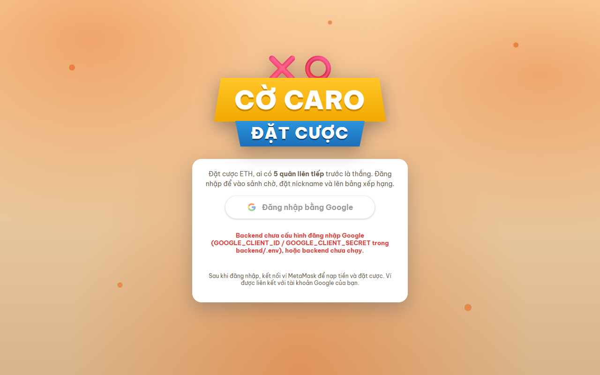
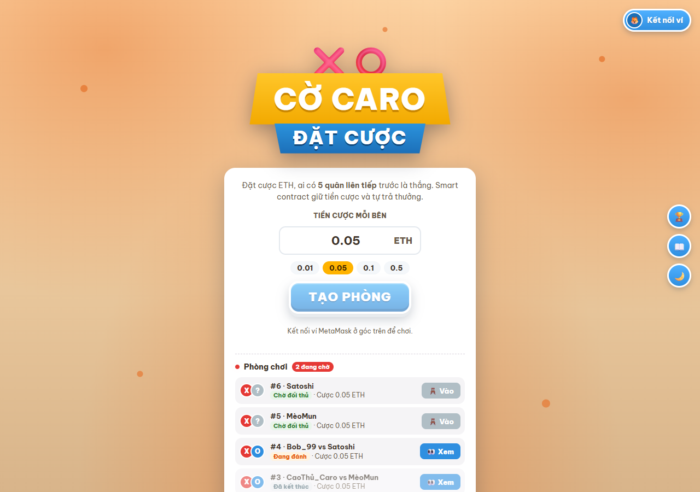
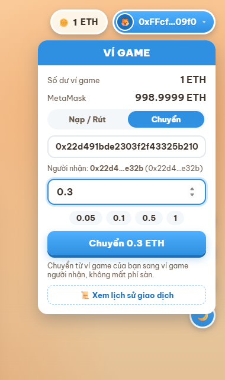
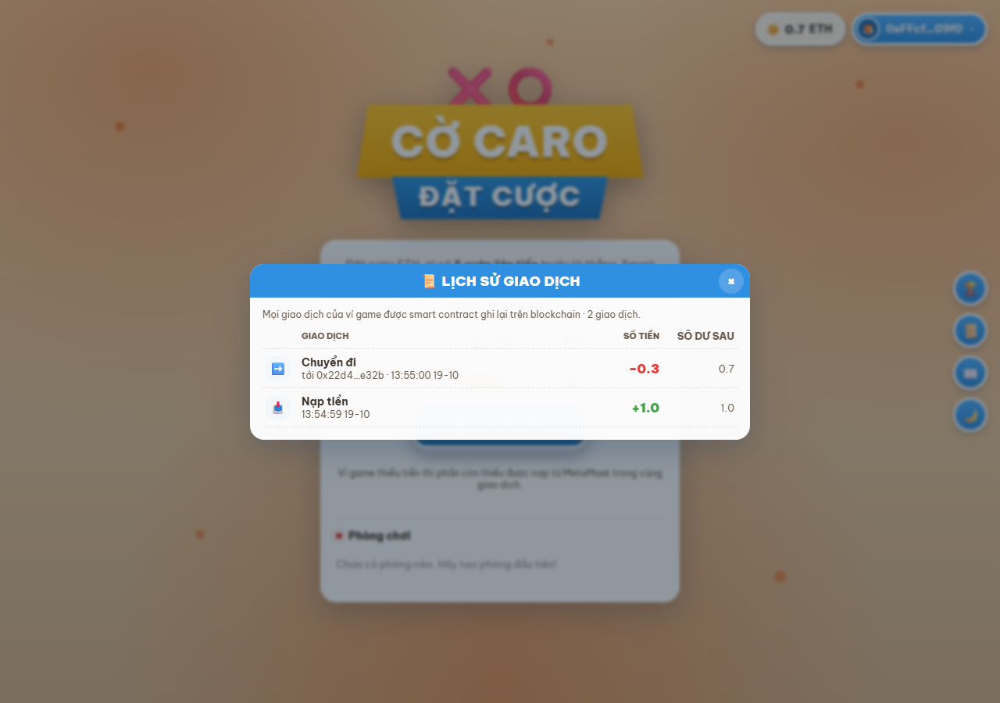
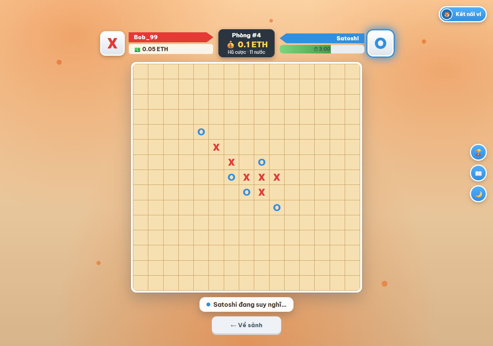
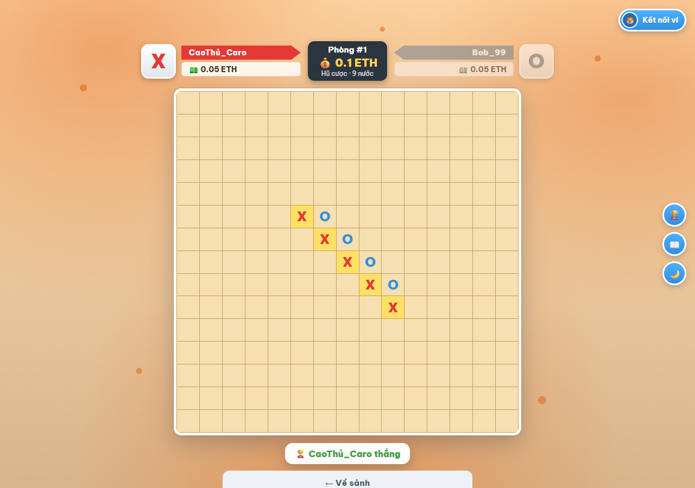
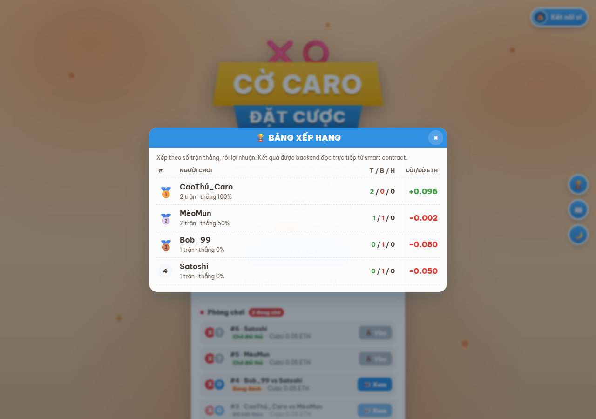
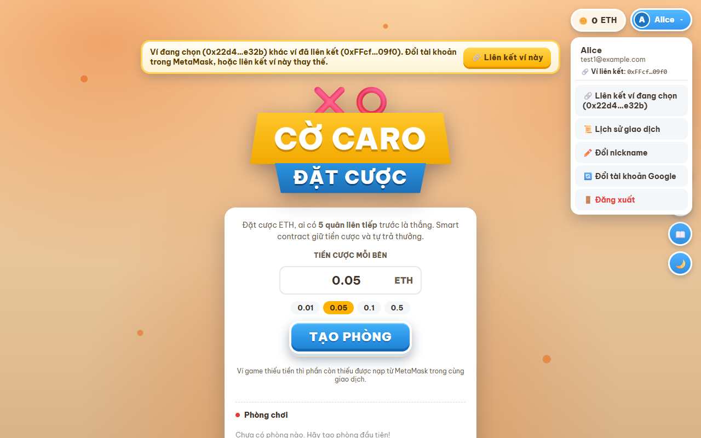
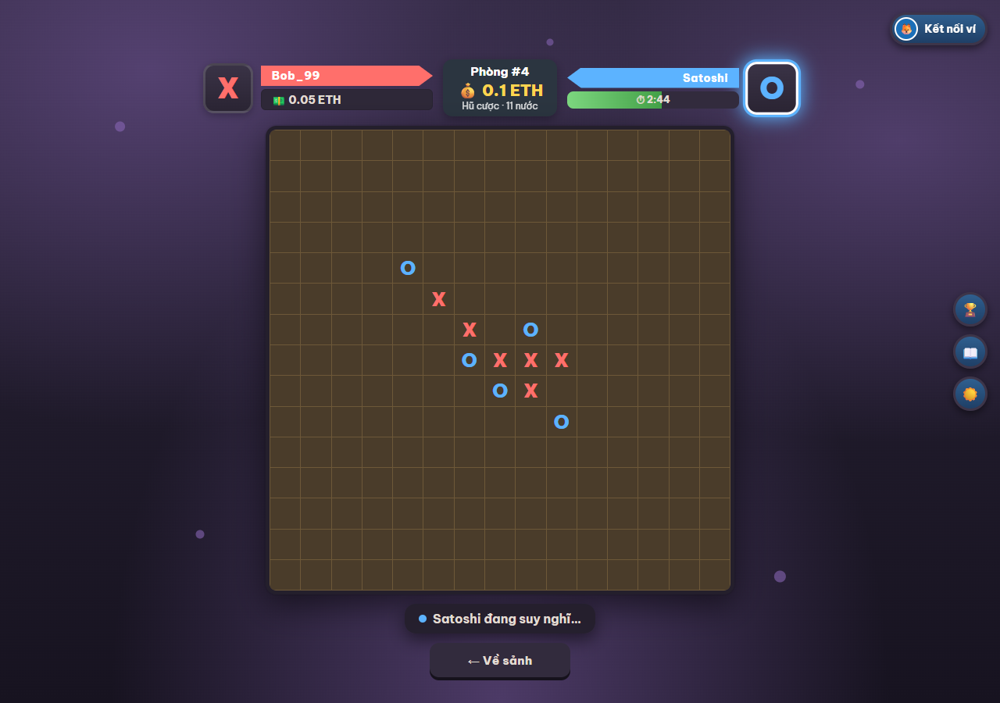
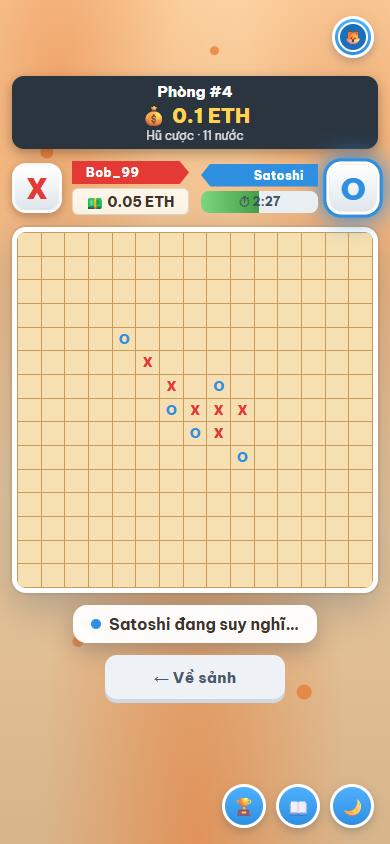

# Ví điện tử Blockchain & Cờ Caro đặt cược

## Giới thiệu

Đề tài **Xây dựng hợp đồng thông minh quản lý ví điện tử đơn giản**: cho phép nạp, rút, chuyển token; kiểm tra số dư; ghi lại lịch sử giao dịch. Smart contract viết bằng **Solidity**, chạy trên **Ganache**, có thể biên dịch và thử trực tiếp trên **Remix IDE**.

Để minh hoạ ví được dùng trong thực tế, dự án kết hợp ví với game **Cờ Caro 15×15 đặt cược**: hai người chơi khoá tiền cược vào smart contract (escrow), mọi nước đi được lưu trên blockchain, contract tự kiểm tra 5 quân liên tiếp và trả thưởng vào ví người thắng — không ai có thể gian lận kết quả.

### Tính năng chính

- **Ví điện tử trên smart contract**: nạp, rút, chuyển ETH giữa người dùng, kiểm tra số dư
- **Lịch sử giao dịch lưu trên blockchain**: loại giao dịch, số tiền, người đối ứng, số dư sau giao dịch, thời gian
- **Cờ Caro đặt cược**: tạo/vào/huỷ phòng, đánh cờ on-chain, hết giờ, đầu hàng, trả thưởng tự động (phí sàn 2%)
- **Đăng nhập bằng Google** (OAuth 2.0), chuyển qua lại giữa các tài khoản
- **Liên kết ví MetaMask** với tài khoản bằng chữ ký số (chứng minh sở hữu ví)
- **Bảng xếp hạng** đồng bộ từ sự kiện của smart contract (không thể làm giả); **Top 5 cao thủ** hiện ngay ở sảnh chờ
- Nickname, giao diện sáng/tối, màu nền theo mùa, hỗ trợ điện thoại

### Đối chiếu yêu cầu đề bài

| Yêu cầu | Đáp ứng |
|---|---|
| Nạp token | `deposit()` — nút **Nạp** trong popover 🪙 Ví game |
| Rút token | `withdraw(amount)` — nút **Rút** |
| Chuyển token | `transfer(to, amount)` — tab **Chuyển** (nhập nickname hoặc địa chỉ ví) |
| Kiểm tra số dư | `balanceOf(user)` — chip 🪙 ở góc trên phải |
| Ghi lại lịch sử giao dịch | `getHistoryCount(user)`, `getHistory(user, start, count)` + event — nút 📜 |
| Solidity | [smart-contract/contracts/CaroBetting.sol](smart-contract/contracts/CaroBetting.sol) |
| Remix IDE | Mục [Chạy với Remix IDE](#6-chạy-với-remix-ide) |
| Ganache | `npm run ganache` + `npm run deploy:ganache` (hoặc Ganache GUI, cổng 7545) |

> "Token" trong dự án là **ETH** — đồng tiền gốc của blockchain (trên Ganache là ETH giả để test).

---

## Công nghệ sử dụng

### Frontend
- **Framework**: React 19 với Vite
- **Styling**: CSS thuần (phong cách game: nút 3D, ruy-băng, nền theo mùa, dark mode)
- **Blockchain**: Ethers.js v6 (đọc contract qua JSON-RPC, ký giao dịch qua MetaMask)
- **Hiệu ứng**: canvas-confetti

### Backend
- **Runtime**: Node.js (Express 5)
- **Database**: MySQL 8.4 (Docker), thư viện `mysql2` (raw SQL)
- **Authentication**: Google OAuth 2.0 (`google-auth-library`) + session token
- **Blockchain**: Ethers.js — xác minh chữ ký liên kết ví, đồng bộ sự kiện `GameEnded` vào MySQL
- **Security**: cors, kiểm tra `state` chống CSRF, xác minh chữ ký ví

### Blockchain
- **Smart Contract**: Solidity 0.8.24
- **Network**: Ganache (chainId 1337, cổng 7545) hoặc Hardhat node (chainId 31337, cổng 8545)
- **Công cụ**: Hardhat (biên dịch, test, deploy), Remix IDE
- **Wallet**: MetaMask

---

## Cấu trúc thư mục

```
blockchain/
├── smart-contract/                 # Hợp đồng thông minh (Hardhat)
│   ├── contracts/
│   │   └── CaroBetting.sol         # Ví điện tử + Cờ Caro đặt cược
│   ├── scripts/
│   │   ├── deploy.js               # Deploy, ghi địa chỉ + ABI + RPC cho frontend/backend
│   │   └── demo-wallet.js          # Demo nạp/rút/chuyển/số dư/lịch sử trên Ganache
│   ├── test/
│   │   └── CaroBetting.test.js     # 15 unit test
│   ├── hardhat.config.js           # Mạng localhost (Hardhat) và ganache
│   └── package.json
├── backend/                        # API Express + MySQL
│   ├── src/
│   │   ├── index.js                # Entry point, khởi tạo DB, mount routes
│   │   ├── db.js                   # Kết nối MySQL, tạo bảng
│   │   ├── auth.js                 # Đăng nhập Google, nickname, liên kết ví
│   │   ├── indexer.js              # Đồng bộ kết quả trận từ blockchain vào MySQL
│   │   ├── leaderboard.js          # API bảng xếp hạng
│   │   └── contracts/CaroBetting.json  # Địa chỉ + ABI (sinh bởi deploy.js)
│   ├── docker-compose.yml          # MySQL 8.4 (cổng 3307)
│   ├── .env.example
│   └── package.json
├── frontend/                       # Giao diện React
│   ├── src/
│   │   ├── components/
│   │   │   ├── LoginPage.jsx       # Trang đăng nhập Google
│   │   │   ├── AccountBar.jsx      # Ví game (nạp/rút/chuyển) + menu tài khoản
│   │   │   ├── TxHistory.jsx       # Lịch sử giao dịch đọc từ smart contract
│   │   │   ├── Lobby.jsx           # Sảnh chờ: tạo/vào/huỷ phòng
│   │   │   ├── GameBoard.jsx       # Bàn cờ 15×15, đồng hồ, kết thúc trận
│   │   │   ├── Leaderboard.jsx     # Bảng xếp hạng đầy đủ
│   │   │   ├── TopPlayers.jsx      # Top 5 ở sảnh chờ
│   │   │   ├── NicknameDialog.jsx
│   │   │   └── RulesModal.jsx
│   │   ├── lib/
│   │   │   ├── caro.js             # Kết nối contract, MetaMask, tiện ích
│   │   │   ├── api.js              # Gọi backend, token, liên kết ví
│   │   │   └── theme.js            # Sáng/tối, màu theo mùa
│   │   ├── contracts/CaroBetting.json  # Địa chỉ + ABI (sinh bởi deploy.js)
│   │   ├── App.jsx
│   │   └── main.jsx
│   ├── vite.config.js              # Proxy /api → http://localhost:4000
│   └── package.json
└── docs/screenshots/               # Ảnh giao diện
```

---

## Hướng dẫn cài đặt & chạy

### Yêu cầu môi trường

- **Node.js**: v22 trở lên (đã chạy trên v24)
- **npm**
- **Docker Desktop**: để chạy MySQL (hoặc MySQL 8 cài sẵn — sửa `DB_*` trong `.env`)
- **MetaMask**: extension cho trình duyệt
- **Ganache**: dùng bản CLI có sẵn trong dự án (`npm run ganache`) hoặc Ganache GUI

### 1. Clone repository và cài đặt

```bash
git clone <repository-url>
cd blockchain
cd smart-contract && npm install
cd ../backend && npm install
cd ../frontend && npm install
```

### 2. Cài đặt Database

#### Chạy MySQL bằng Docker

```bash
cd backend
docker compose up -d
```

MySQL chạy ở cổng **3307** (tránh đụng MySQL cài sẵn ở 3306), database `caro_betting`, user `caro` / `caro`. **Không cần import file SQL**: backend tự tạo database và các bảng khi khởi động.

#### Database Schema (các bảng chính)

- `users` — Tài khoản Google (google_id, email, tên, ảnh), nickname, ví MetaMask đã liên kết
- `sessions` — Phiên đăng nhập (token, hạn dùng)
- `matches` — Kết quả trận đồng bộ từ sự kiện `GameEnded` trên blockchain
- `meta` — Trạng thái đồng bộ (block cuối đã đọc)

> Số dư và lịch sử giao dịch của ví **không** lưu trong MySQL mà lưu trên blockchain (trong smart contract).

### 3. Chạy blockchain Ganache và deploy Smart Contract

```bash
cd smart-contract
npm run ganache            # Terminal 1: Ganache tại http://127.0.0.1:7545, chainId 1337
npm run deploy:ganache     # Terminal 2: deploy contract
```

Ganache in ra 10 tài khoản (mỗi tài khoản 1000 ETH) kèm private key. Script deploy tự ghi địa chỉ contract, ABI và RPC vào `frontend/src/contracts/` và `backend/src/contracts/` — **không cần copy địa chỉ bằng tay**.

Dùng Ganache GUI cũng được: tạo workspace cổng 7545 rồi chỉ chạy `npm run deploy:ganache`. Muốn dùng Hardhat node: `npm run node` + `npm run deploy`.

### 4. Cấu hình Backend

#### Tạo file `.env`

```bash
cd backend
cp .env.example .env
```

```env
# Server
PORT=4000
CLIENT_URL=http://localhost:5173

# Blockchain (dự phòng; mặc định lấy RPC từ file deploy)
RPC_URL=http://127.0.0.1:8545

# Database (MySQL Docker)
DB_HOST=127.0.0.1
DB_PORT=3307
DB_USER=caro
DB_PASSWORD=caro
DB_NAME=caro_betting

# Đăng nhập Google — OAuth client loại "Web application"
GOOGLE_CLIENT_ID=your_client_id.apps.googleusercontent.com
GOOGLE_CLIENT_SECRET=your_client_secret
GOOGLE_CALLBACK_URL=http://localhost:4000/auth/google/callback
```

`GOOGLE_CALLBACK_URL` phải nằm trong **Authorized redirect URIs** của OAuth client (Google Cloud Console → APIs & Services → Credentials).

#### Chạy backend

```bash
npm run dev
```

Server chạy tại: `http://localhost:4000` (tự khởi động lại khi sửa `src/` hoặc `.env`).

### 5. Chạy Frontend

```bash
cd frontend
npm run dev
```

Frontend chạy tại: `http://localhost:5173` (gọi backend qua proxy `/api`, không cần file `.env`).

> Mỗi lần khởi động lại Ganache cần chạy lại `npm run deploy:ganache`, và trong MetaMask vào *Settings → Advanced → Clear activity tab data* để tránh lỗi nonce.

### 6. Chạy với Remix IDE

Contract là một file Solidity không import thư viện ngoài, dán thẳng vào Remix được:

1. Mở https://remix.ethereum.org, tạo file `CaroBetting.sol`, dán nội dung [smart-contract/contracts/CaroBetting.sol](smart-contract/contracts/CaroBetting.sol).
2. Tab **Solidity Compiler**: chọn compiler `0.8.24`, bật *Optimization* (200 runs), bấm **Compile**.
3. Tab **Deploy & Run Transactions**, chọn Environment:
   - **Remix VM** để thử nhanh trong trình duyệt, hoặc
   - **Dev - Ganache Provider** (`http://127.0.0.1:7545`) để deploy lên Ganache, hoặc
   - **Injected Provider - MetaMask** khi MetaMask đang ở mạng Ganache Local.
4. Bấm **Deploy**, rồi thử các hàm ví:
   - `deposit`: nhập số ETH vào ô **Value** (vd. `1 ether`) rồi bấm `deposit`
   - `balanceOf`: dán địa chỉ ví → xem số dư (wei)
   - `transfer`: nhập `to` (địa chỉ khác trong danh sách Account) và `amount` (wei, vd. `300000000000000000` = 0.3 ETH)
   - `withdraw`: nhập `amount` (wei)
   - `getHistoryCount` / `getHistory(user, 0, 10)`: xem lịch sử; terminal Remix hiện các event `Deposited`, `Transferred`, `Withdrawn`
5. Muốn web dùng contract deploy từ Remix: sửa `address` trong `frontend/src/contracts/CaroBetting.json` và `backend/src/contracts/CaroBetting.json` (cùng mạng Ganache).

---

## Tài khoản demo

### Đăng nhập web

Dùng **tài khoản Google** bất kỳ (nút *Đăng nhập bằng Google*). Lần đầu đăng nhập sẽ được hỏi đặt nickname. Muốn đổi tài khoản: menu tài khoản → *Đổi tài khoản Google*.

### Ví MetaMask (Ganache, chạy với `--wallet.deterministic`)

Import private key vào MetaMask (*Add account → Import account*). Khi bấm **Kết nối ví**, app tự thêm mạng **Ganache Local** (chainId 1337, RPC `http://127.0.0.1:7545`).

| Tài khoản | Địa chỉ | Private key | Vai trò |
|------|----------|----------|-------|
| **#0** | `0x90F8bf6A479f320ead074411a4B0e7944Ea8c9C1` | `0x4f3edf983ac636a65a842ce7c78d9aa706d3b113bce9c46f30d7d21715b23b1d` | Ví deploy contract, nhận phí sàn 2% |
| **#1 (Alice)** | `0xFFcf8FDEE72ac11b5c542428B35EEF5769C409f0` | `0x6cbed15c793ce57650b9877cf6fa156fbef513c4e6134f022a85b1ffdd59b2a1` | Người chơi 1 |
| **#2 (Bob)** | `0x22d491Bde2303f2f43325b2108D26f1eAbA1e32b` | `0x6370fd033278c143179d81c5526140625662b8daa446c22ee2d73db3707e620c` | Người chơi 2 |

> Đây là khoá công khai của Ganache dùng để test, **không bao giờ** dùng cho tiền thật.
>
> Hai người chơi trên cùng một máy cần 2 trình duyệt/profile (mỗi trình duyệt giữ một phiên đăng nhập).

### Demo chức năng ví bằng script

```bash
cd smart-contract
npm run demo:ganache
```

Script [scripts/demo-wallet.js](smart-contract/scripts/demo-wallet.js) dùng Alice và Bob gọi contract đang deploy trên Ganache, in ra tx hash, block, event và số dư từng bước:

```
1) NẠP: Alice nạp 1 ETH từ MetaMask vào ví — deposit()
  ✔ deposit 1 ETH
    tx hash : 0x472ac00acbf979c18c06c4554b43596159257ecec69625192ef756cefff4b02e
    block   : #2   gas: 138996
    event   : Deposited(0xFFcf8FDEE72ac11b5c542428B35EEF5769C409f0, 1.0 ETH)

3) CHUYỂN: Alice chuyển 0.3 ETH cho Bob — transfer()
    event   : Transferred(0xFFcf…09f0, 0x22d4…e32b, 0.3 ETH)
    Alice 0xFFcf…09f0  ví game: 0.7 ETH
    Bob   0x22d4…e32b  ví game: 0.3 ETH

5) CHẶN GIAO DỊCH SAI (contract revert, không mất tiền)
  ✔ Bob rút 100 ETH (quá số dư): bị chặn — "So du khong du"
  ✔ Alice chuyển cho chính mình: bị chặn — "Khong the chuyen cho chinh minh"
  ✔ Alice chuyển tới địa chỉ 0x0: bị chặn — "Dia chi nguoi nhan khong hop le"

6) LỊCH SỬ GIAO DỊCH lưu trên blockchain — getHistory()
  Alice:
    - Nạp tiền   1.0 ETH   số dư sau: 1.0 ETH
    - Chuyển đi  0.3 ETH   số dư sau: 0.7 ETH   đối ứng 0x22d4…e32b
  Bob:
    - Nhận tiền  0.3 ETH   số dư sau: 0.3 ETH   đối ứng 0xFFcf…09f0
    - Rút tiền   0.1 ETH   số dư sau: 0.2 ETH
```

### Báo cáo kiểm thử

Kết quả kiểm thử toàn bộ hệ thống (27 trường hợp, kèm ảnh chụp từng bước): [docs/TEST_REPORT.md](docs/TEST_REPORT.md).

### Unit test

```bash
cd smart-contract
npm test
```

15 test: nạp/rút, chuyển tiền và các trường hợp bị chặn, lịch sử giao dịch (thứ tự, số dư sau, phân trang), luật thắng 5 quân, hết giờ, đầu hàng, phí sàn, hoàn cược.

---

## Kết quả và giao diện

### 1. Trang đăng nhập Google

*Chỉ đăng nhập bằng Google; ví MetaMask được liên kết sau khi đăng nhập*

### 2. Sảnh chờ

*Tạo phòng với mức cược, danh sách phòng đang chờ / đang đánh / đã kết thúc*

### 3. Ví game — Nạp / Rút / Chuyển

*Số dư ví game và MetaMask; chuyển tiền bằng nickname hoặc địa chỉ ví*

### 4. Lịch sử giao dịch

*Đọc trực tiếp từ smart contract: loại giao dịch, số tiền, người đối ứng, số dư sau, thời gian*

### 5. Bàn cờ — đang đánh

*Thẻ người chơi, đồng hồ 5 phút mỗi lượt, hũ cược đang khoá trong contract*

### 6. Kết thúc trận

*Contract tự xác định người thắng, tô sáng hàng 5 quân, trả thưởng vào ví*

### 7. Bảng xếp hạng

*Đồng bộ từ sự kiện `GameEnded` của smart contract*

### 8. Menu tài khoản & liên kết ví

*Đổi tài khoản Google, cảnh báo khi ví MetaMask đang chọn khác ví đã liên kết*

### 9. Chế độ tối & điện thoại



---

## Bảo mật Smart Contract — Phân tích

### Lỗ hổng "tự tuyên bố người thắng"

Thiết kế ban đầu có hàm:

```solidity
function claimVictory(uint256 _gameId, address _winner) public {
    ...
    balances[_winner] += game.betAmount * 2;
}
```

#### Vấn đề:
- **Bất kỳ ai** (kể cả người ngoài) gọi được và tự chỉ định người thắng
- Người chơi thua có thể gọi `claimVictory(id, chínhMình)` để lấy toàn bộ hũ cược
- Kết quả phụ thuộc vào web/backend "báo" lên → không còn tính minh bạch của blockchain

#### Cách khắc phục trong dự án:
✅ Bỏ hàm `claimVictory`; mọi nước đi gửi lên contract qua `makeMove(id, x, y)`  
✅ Contract tự kiểm tra lượt, ô trống, và 5 quân liên tiếp (ngang, dọc, 2 đường chéo)  
✅ Người thắng chỉ được xác định bởi contract → không thể gian lận  
✅ `claimTimeout` chỉ cho **đối thủ của người hết giờ** nhận thắng, sau đúng 5 phút  

### Các biện pháp an toàn khác

| Nguy cơ | Biện pháp |
|---|---|
| Reentrancy khi rút tiền | `withdraw` trừ số dư **trước** khi chuyển ETH (checks-effects-interactions) |
| Chuyển tiền sai | `transfer` chặn người nhận `0x0`, tự chuyển cho mình, số tiền 0, số dư không đủ |
| Tiền bị kẹt khi đối thủ bỏ đi | Hết giờ thì đối thủ nhận thắng; phòng chưa có người vào thì chủ phòng huỷ và được hoàn tiền |
| Gắn ví của người khác vào tài khoản | Liên kết ví bắt buộc **ký message** bằng ví đó; backend xác minh chữ ký, mỗi ví chỉ thuộc một tài khoản |
| Giả mạo bảng xếp hạng | Backend chỉ đọc kết quả từ sự kiện `GameEnded` do contract phát ra, client không gửi kết quả |
| CSRF khi đăng nhập Google | Tham số `state` ngẫu nhiên, dùng một lần, hết hạn sau 10 phút |
| Lộ secret | `backend/.env` không đưa lên git (`.gitignore`) |

### Đoạn code an toàn tiêu biểu

**File**: `smart-contract/contracts/CaroBetting.sol`

```solidity
function withdraw(uint256 amount) external {
    require(amount > 0, "So tien rut phai lon hon 0");
    require(balances[msg.sender] >= amount, "So du khong du");
    balances[msg.sender] -= amount; // trừ trước khi chuyển để chống reentrancy
    _record(msg.sender, TxType.Withdraw, address(0), amount, 0);
    (bool ok, ) = payable(msg.sender).call{value: amount}("");
    require(ok, "Chuyen tien that bai");
    emit Withdrawn(msg.sender, amount);
}

function transfer(address to, uint256 amount) external {
    require(to != address(0), "Dia chi nguoi nhan khong hop le");
    require(to != msg.sender, "Khong the chuyen cho chinh minh");
    require(amount > 0, "So tien chuyen phai lon hon 0");
    require(balances[msg.sender] >= amount, "So du khong du");

    balances[msg.sender] -= amount;
    balances[to] += amount;
    _record(msg.sender, TxType.TransferOut, to, amount, 0);   // ghi lịch sử người gửi
    _record(to, TxType.TransferIn, msg.sender, amount, 0);    // ghi lịch sử người nhận
    emit Transferred(msg.sender, to, amount);
}
```
