# Báo cáo kiểm thử hệ thống

**Thời gian:** 14:40:34 19/10/2026 · **Kết quả:** 27/27 đạt

## Môi trường

| Thành phần | Giá trị |
|---|---|
| Blockchain | Ganache, `http://127.0.0.1:7545`, chainId 1337 |
| Smart contract | `CaroBetting` tại `0xe78A0F7E598Cc8b0Bb87894B0F60dD2a88d6a8Ab` |
| Backend | Express, `http://localhost:4000`, MySQL 8.4 (Docker, cổng 3307) |
| Frontend | React + Vite, `http://localhost:5173` |
| Đăng nhập | Google OAuth 2.0 (client thật, đã cấu hình trong `backend/.env`) |
| Trình duyệt | Microsoft Edge (headless, tự động bằng Playwright) |

## Cách kiểm thử

- **T01–T03, T24**: dùng OAuth client Google thật — kiểm tra tới trang đăng nhập của Google (không lỗi `redirect_uri_mismatch`), chống CSRF, đổi tài khoản. Bước nhập mật khẩu Google cần người thật nên không tự động hoá.
- **T04–T25**: 2 tài khoản test (Alice, Bob) được tạo tạm trong MySQL thay cho bước đăng nhập Google; ví MetaMask được giả lập, ký message bằng private key Ganache và gửi giao dịch thật lên Ganache. Mọi giao dịch đều đi qua smart contract thật.
- Tài khoản test đã được xoá sau khi kiểm thử; giao dịch vẫn còn trên Ganache.

## Kết quả

| # | Nhóm | Chức năng | Kết quả | Kết quả thực tế | Ảnh chụp |
|---|---|---|---|---|---|
| T01 | Đăng nhập | Trang đăng nhập Google (backend đã cấu hình) | ✅ Đạt | Nút "Đăng nhập bằng Google" bấm được |  |
| T02 | Đăng nhập | Chuyển sang trang đăng nhập của Google | ✅ Đạt | Google hiện trang chọn tài khoản, không lỗi OAuth (redirect_uri=http://localhost:4000/auth/google/callback) | <a href="screenshots/test/T02.png">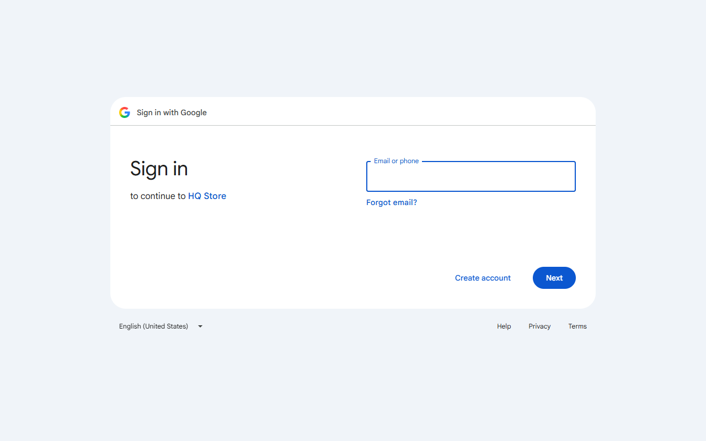</a> |
| T03 | Bảo mật | Callback Google với state giả bị từ chối (chống CSRF) | ✅ Đạt | ⚠️ Yêu cầu đăng nhập không hợp lệ hoặc đã hết hạn, hãy thử lại | <a href="screenshots/test/T03.png">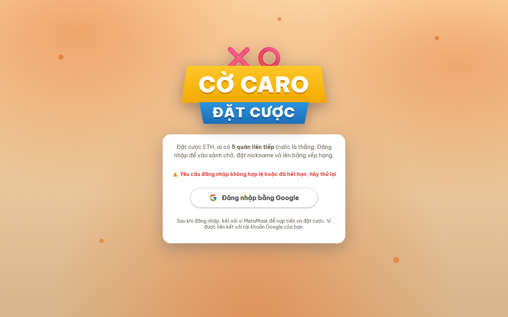</a> |
| T04 | Đăng nhập | Vào sảnh sau khi đăng nhập (tài khoản Google) | ✅ Đạt | Hiện tên Google: Alice Nguyễn | <a href="screenshots/test/T04.png">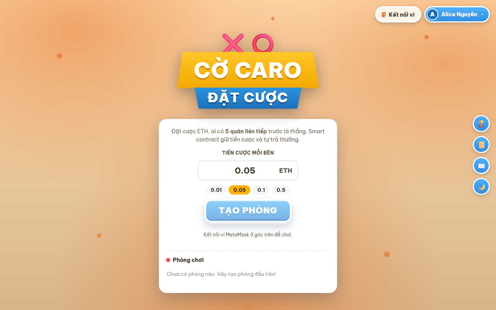</a> |
| T05 | Liên kết ví | Kết nối ví MetaMask → cảnh báo chưa liên kết | ✅ Đạt | Ví MetaMask này chưa liên kết với tài khoản. Liên kết để tên của bạn hiện trên sảnh và bảng xếp hạng. | <a href="screenshots/test/T05.png">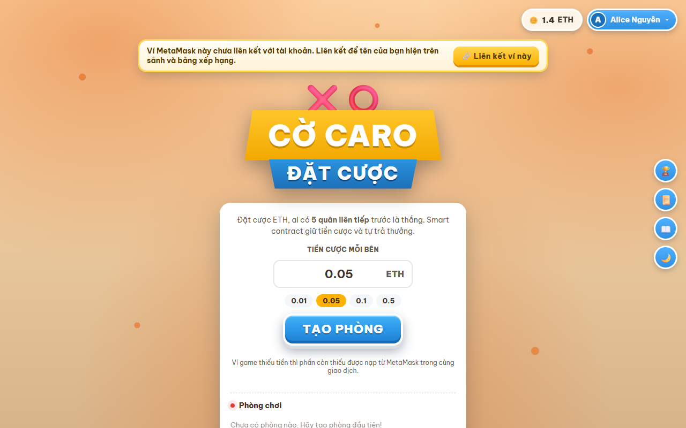</a> |
| T06 | Liên kết ví | Liên kết ví bằng chữ ký số | ✅ Đạt | Đã liên kết ví 0xFFcf…09f0 với tài khoản | <a href="screenshots/test/T06.png">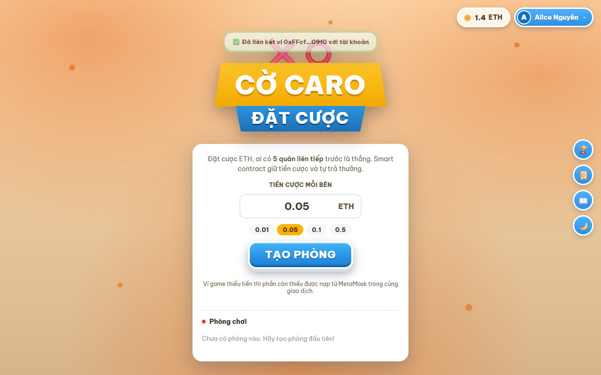</a> |
| T07 | Tài khoản | Đặt nickname | ✅ Đạt | Tên hiển thị: Alice_Test | <a href="screenshots/test/T07a.png">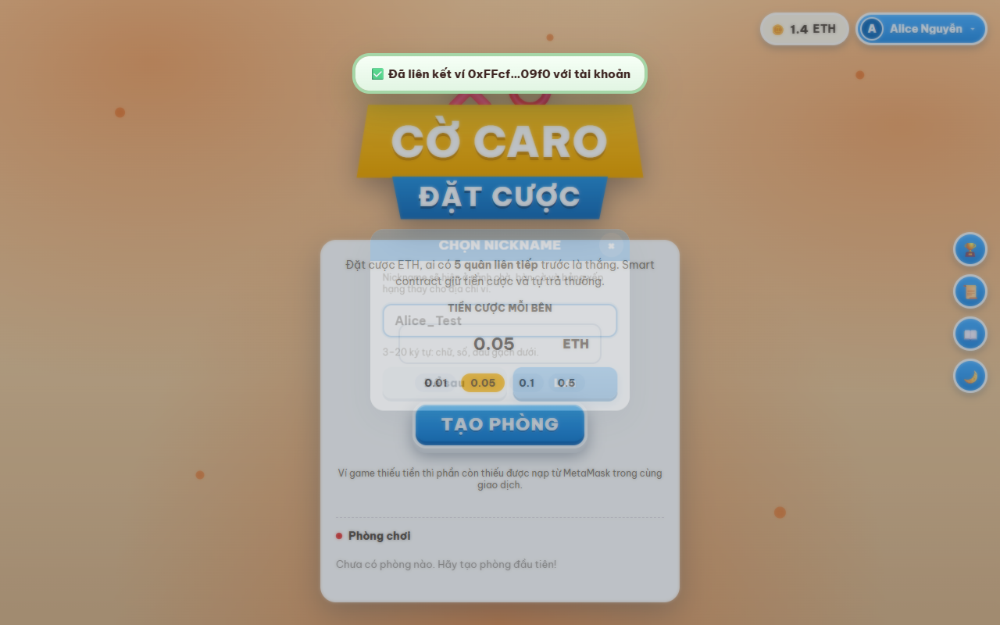</a>  |
| T08 | Liên kết ví | Người chơi thứ 2 (Bob) đăng nhập + liên kết ví + nickname | ✅ Đạt | Tên hiển thị: Bob_Test | <a href="screenshots/test/T08.png">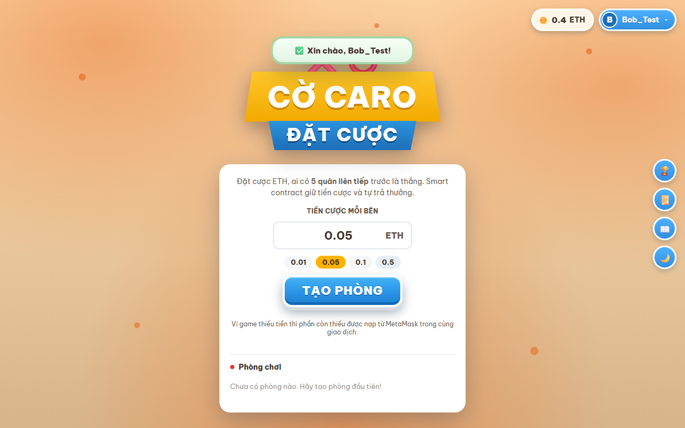</a> |
| T09 | Bảo mật | Chặn liên kết ví đã thuộc tài khoản khác | ✅ Đạt | HTTP 409 — Ví này đã được liên kết với một tài khoản Google khác | — (kiểm tra qua API) |
| T10 | Ví điện tử | Nạp 2 ETH vào ví — deposit() | ✅ Đạt | Số dư ví game: 🪙 1.4 ETH → 🪙 3.4 ETH | <a href="screenshots/test/T10.png">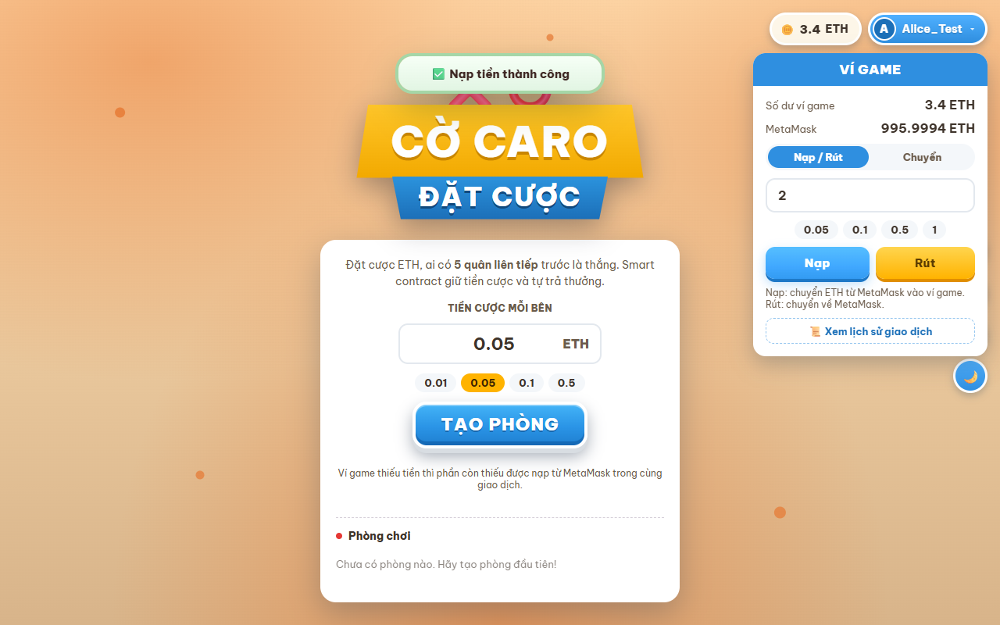</a> |
| T11 | Ví điện tử | Chuyển 0.5 ETH cho Bob bằng nickname — transfer() | ✅ Đạt | Đã chuyển 0.5 ETH cho Bob_Test — ví Alice: 🪙 2.9 ETH |  <a href="screenshots/test/T11.png">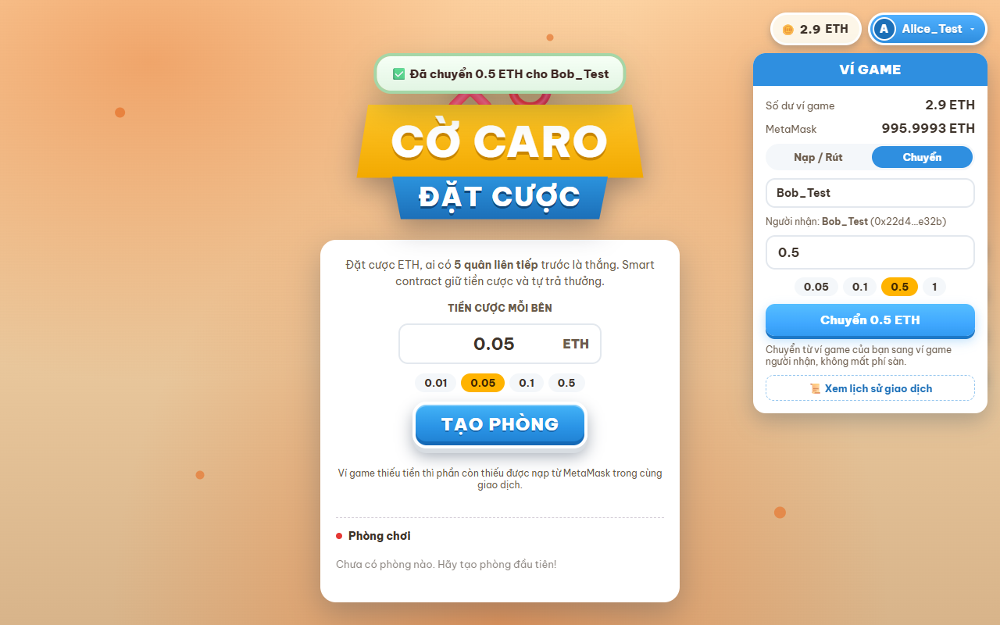</a> |
| T12 | Ví điện tử | Bob kiểm tra số dư nhận được — balanceOf() | ✅ Đạt | Ví game Bob: 🪙 0.9 ETH |  |
| T13 | Ví điện tử | Rút 0.2 ETH về MetaMask — withdraw() | ✅ Đạt | Ví Alice còn: 🪙 2.7 ETH | <a href="screenshots/test/T13.png">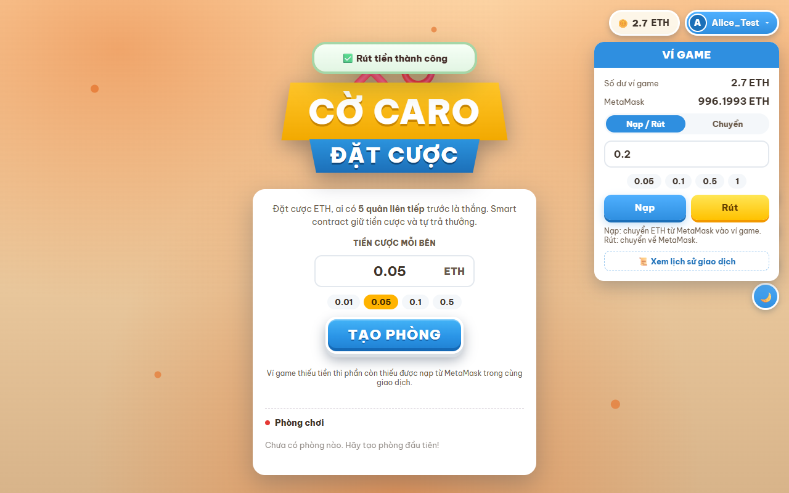</a> |
| T14 | Bảo mật | Rút quá số dư bị contract chặn | ✅ Đạt | So du khong du | <a href="screenshots/test/T14.png">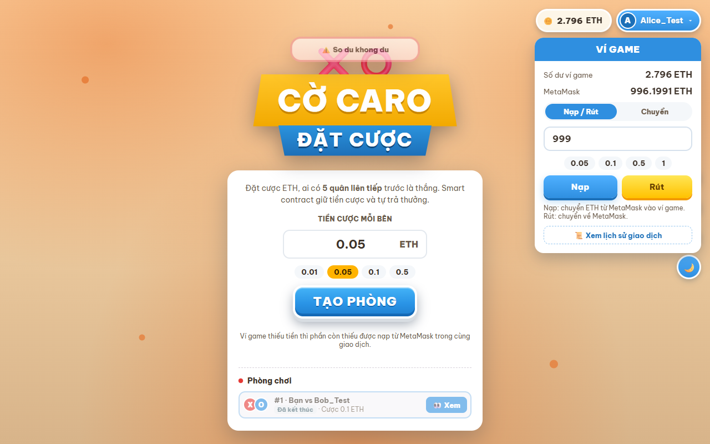</a> |
| T15 | Ví điện tử | Lịch sử giao dịch (Alice) — getHistory() | ✅ Đạt | 7 giao dịch: Rút tiền, Chuyển đi, Nạp tiền, Chuyển đi, Nạp tiền, Chuyển đi, Nạp tiền | <a href="screenshots/test/T15.png">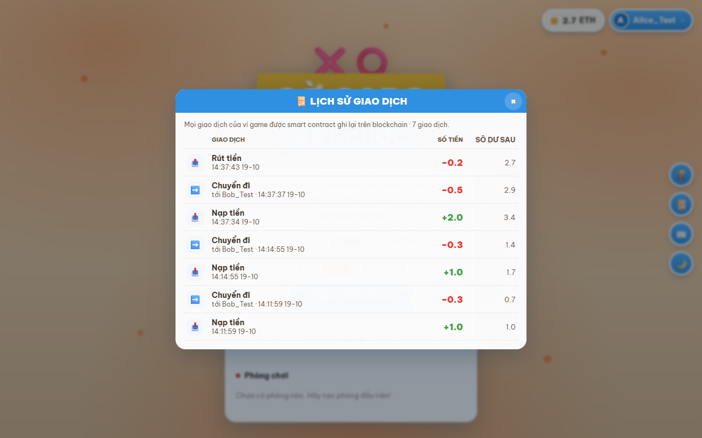</a> |
| T16 | Cờ Caro | Alice tạo phòng cược 0.1 ETH — createRoom() | ✅ Đạt | #1 · Bạn | <a href="screenshots/test/T16.png">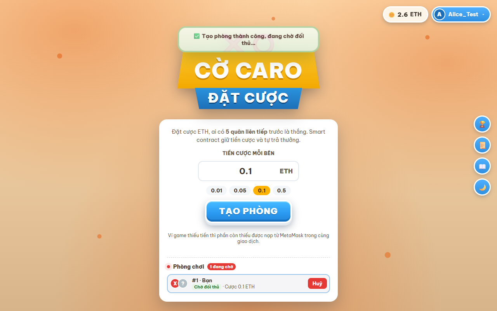</a> |
| T17 | Cờ Caro | Bob vào phòng — joinRoom() | ✅ Đạt | Bàn cờ mở, hũ cược: 💰 0.2 ETH | <a href="screenshots/test/T17.png">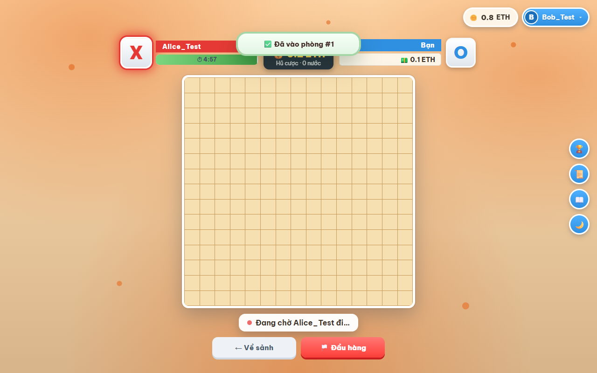</a> |
| T18 | Cờ Caro | Đánh cờ luân phiên trên chain — makeMove() | ✅ Đạt | 8 nước đi (X: 4 quân hàng ngang, O: 4 quân chặn dưới) | <a href="screenshots/test/T18.png">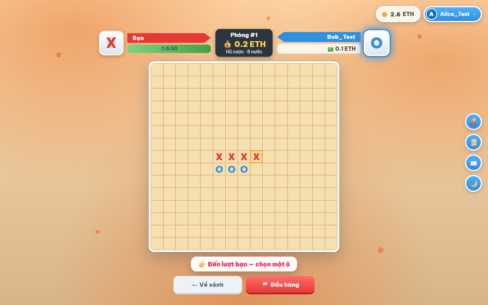</a> |
| T19 | Cờ Caro | Nước thắng: 5 quân liên tiếp → contract trả thưởng | ✅ Đạt | Bạn chiến thắng! +0.196 ETH | <a href="screenshots/test/T19.png">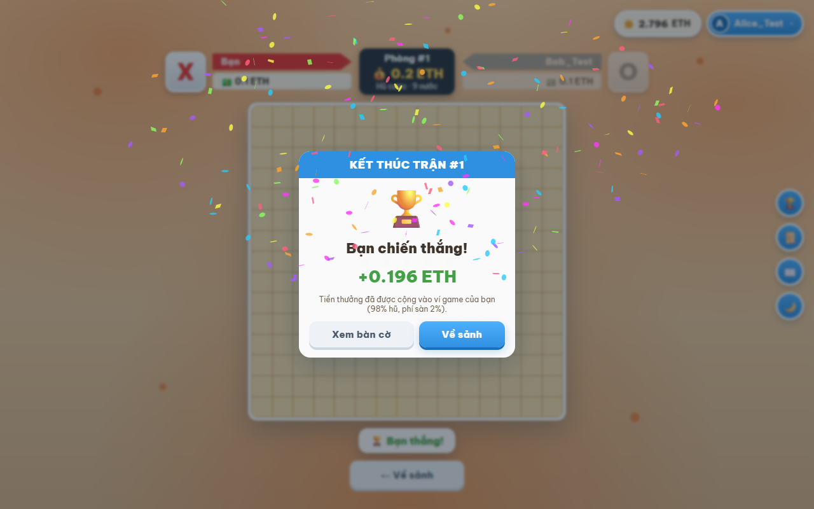</a> |
| T20 | Cờ Caro | Bob thấy kết quả thua trên bàn cờ | ✅ Đạt | 🏆 Alice_Test thắng, 5 ô thắng được tô sáng | <a href="screenshots/test/T20.png">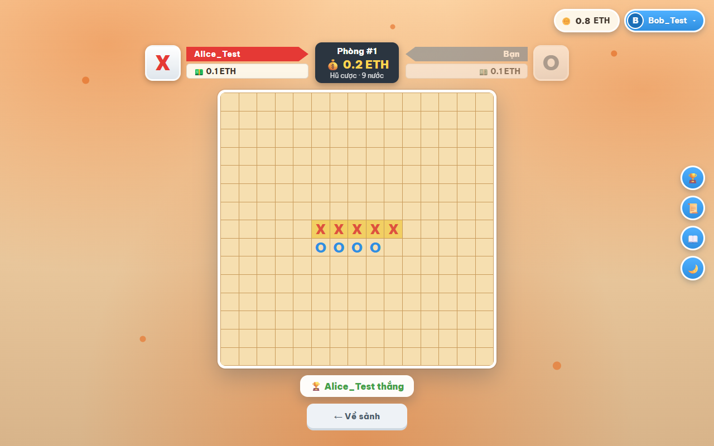</a> |
| T21 | Bảng xếp hạng | Bảng xếp hạng cập nhật từ blockchain | ✅ Đạt | 🥇 Alice_Test (bạn) 1 trận · thắng 100% 1 / 0 / 0 +0.096 | 🥈 Bob_Test 1 trận · thắng 0% 0 / 1 / 0 −0.100 | <a href="screenshots/test/T21.png">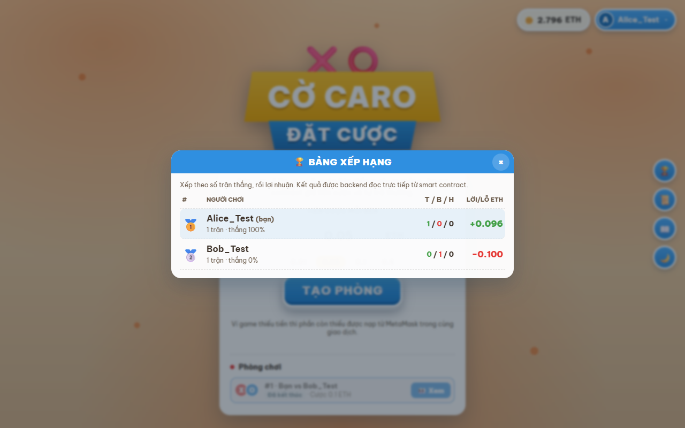</a> |
| T22 | Ví điện tử | Lịch sử giao dịch (Bob): nhận tiền, đặt cược | ✅ Đạt | Đặt cược, Nhận tiền, Rút tiền, Nhận tiền, Rút tiền, Nhận tiền | <a href="screenshots/test/T22.png">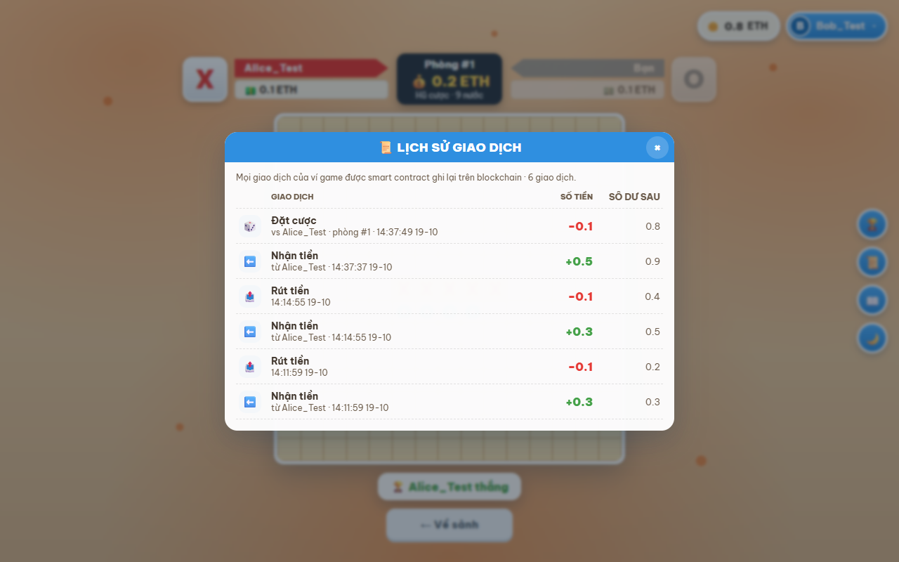</a> |
| T23 | Tài khoản | Menu tài khoản: thông tin Google + ví liên kết | ✅ Đạt | Alice_Testalice.test@example.com🔗 Ví liên kết: 0xFFcf…09f0 | <a href="screenshots/test/T23.png">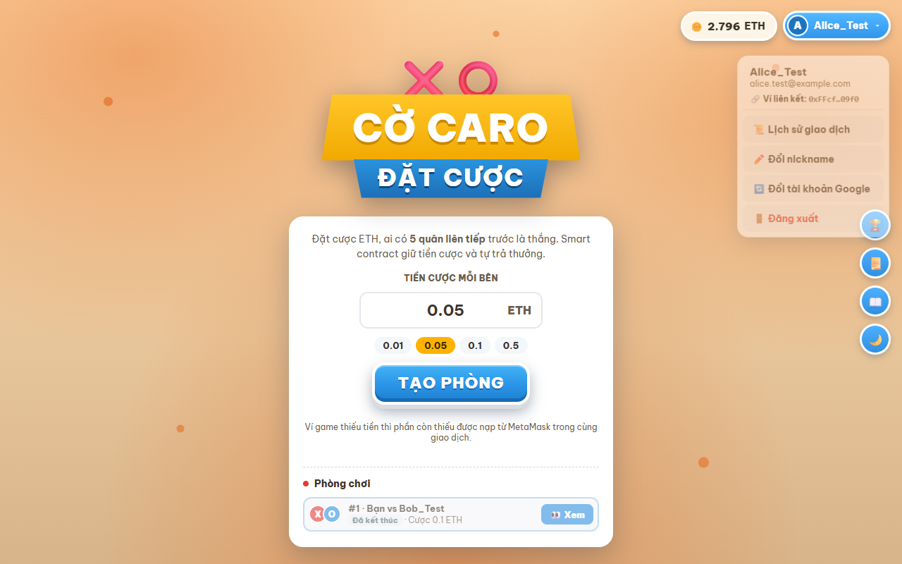</a> |
| T24 | Tài khoản | Đổi tài khoản Google → phiên cũ bị huỷ, mở bảng chọn tài khoản | ✅ Đạt | Phiên cũ trả 401; đang ở trang chọn tài khoản của Google |  |
| T25 | Tài khoản | Đăng xuất → quay về trang đăng nhập | ✅ Đạt | Hiện lại trang đăng nhập Google | <a href="screenshots/test/T25.png">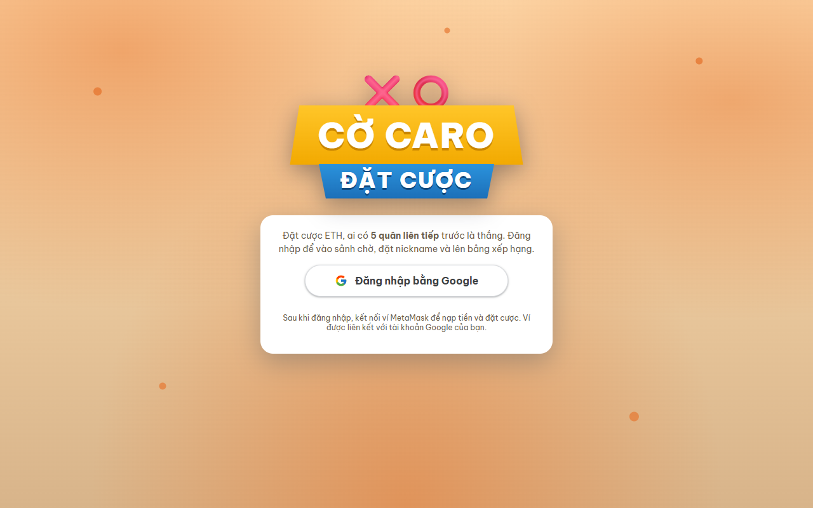</a> |
| T26 | Smart contract | Unit test Hardhat (15 test) | ✅ Đạt | `npm test` → 15 passing | — |
| T27 | Smart contract | Script demo ví trên Ganache | ✅ Đạt | `npm run demo:ganache` → deposit, transfer, withdraw thành công; 3 giao dịch sai bị chặn đúng lý do | — |

## Lỗi phát hiện và đã sửa trong lúc kiểm thử

| Lỗi | Nguyên nhân | Cách sửa |
|---|---|---|
| Thông báo lỗi khi giao dịch bị chặn chỉ hiện "revert" | Ganache đặt lý do lỗi ở `error.data.reason`; MetaMask còn bọc thêm một lớp | `frontend/src/lib/caro.js`: tìm lý do revert qua các lớp lỗi lồng nhau (T14 hiện đúng "So du khong du") |
| Thông báo khi callback Google có `state` giả chưa rõ ("Phiên đăng nhập đã hết hạn") | Dùng chung thông báo với trường hợp hết hạn | Đổi thành "Yêu cầu đăng nhập không hợp lệ hoặc đã hết hạn" |
| Cảnh báo lint `react(set-state-in-effect)` ở `App.jsx` | Gọi `refresh()` đồng bộ trong `useEffect` | Lần đọc blockchain đầu tiên chạy qua `setTimeout(refresh, 0)`, huỷ khi unmount — lint 0 cảnh báo |
| Cảnh báo build: bundle JS 531 kB (> 500 kB) | `ethers` và React nằm chung bundle chính | `vite.config.js`: tách chunk `ethers` (258 kB) và `react` (219 kB); bundle chính còn 54 kB |

Sau khi sửa, chạy lại toàn bộ 25 bước kiểm thử giao diện: **25/25 đạt**; unit test 15/15 đạt.

## Còn tồn tại (không sửa, có lý do)

| Vấn đề | Lý do |
|---|---|
| `npm audit` trong `smart-contract/` báo lỗ hổng ở thư viện phụ thuộc | Chỉ nằm trong **devDependencies** (Hardhat 2, hardhat-toolbox, Ganache) dùng để biên dịch/chạy blockchain local, không có trong app chạy thật (frontend, backend: 0 lỗ hổng). Mọi bản sửa đều cần nâng major (Hardhat 3, toolbox 7); `ganache` 7.9.2 là bản cuối cùng (dự án đã ngừng phát triển) nên không có bản vá |
| Trang đăng nhập Google hiện tên app **"HQ Store"** | Là cấu hình của project Google Cloud, không phải code — đổi tại Google Auth Platform → Branding → App name |
